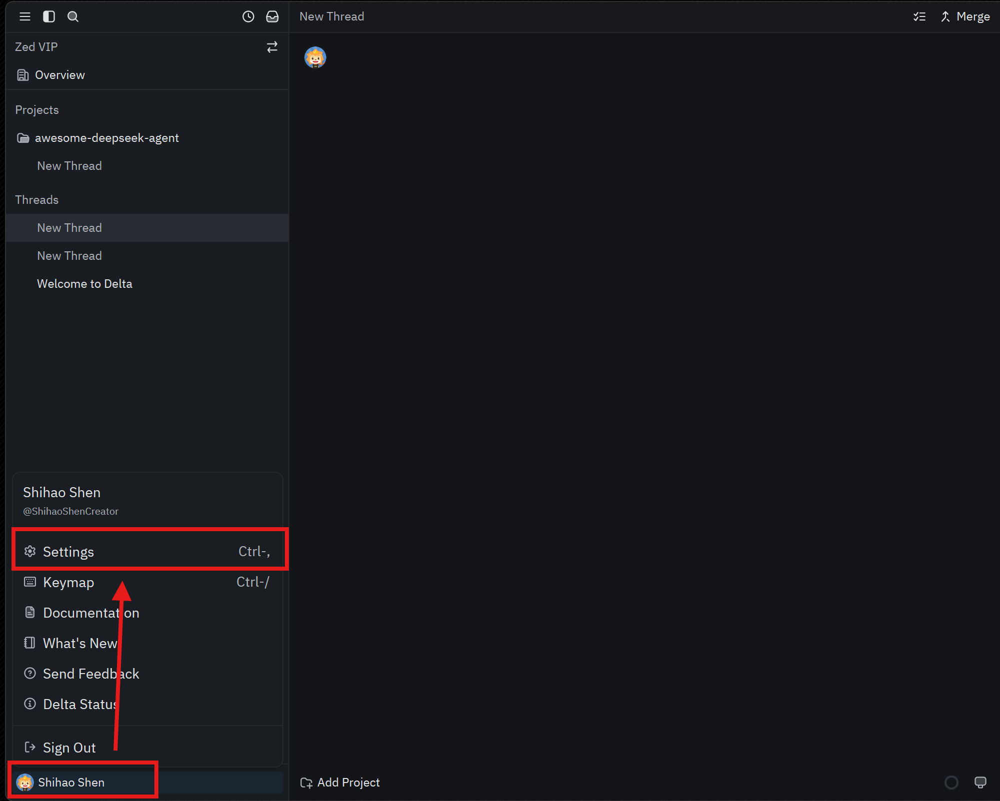
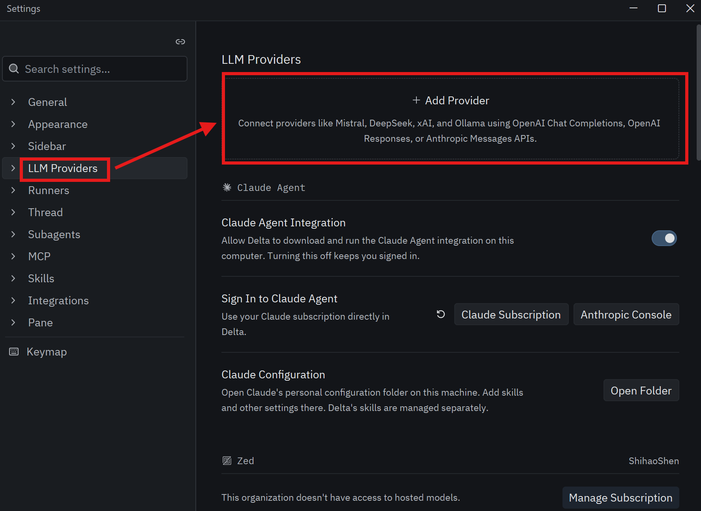
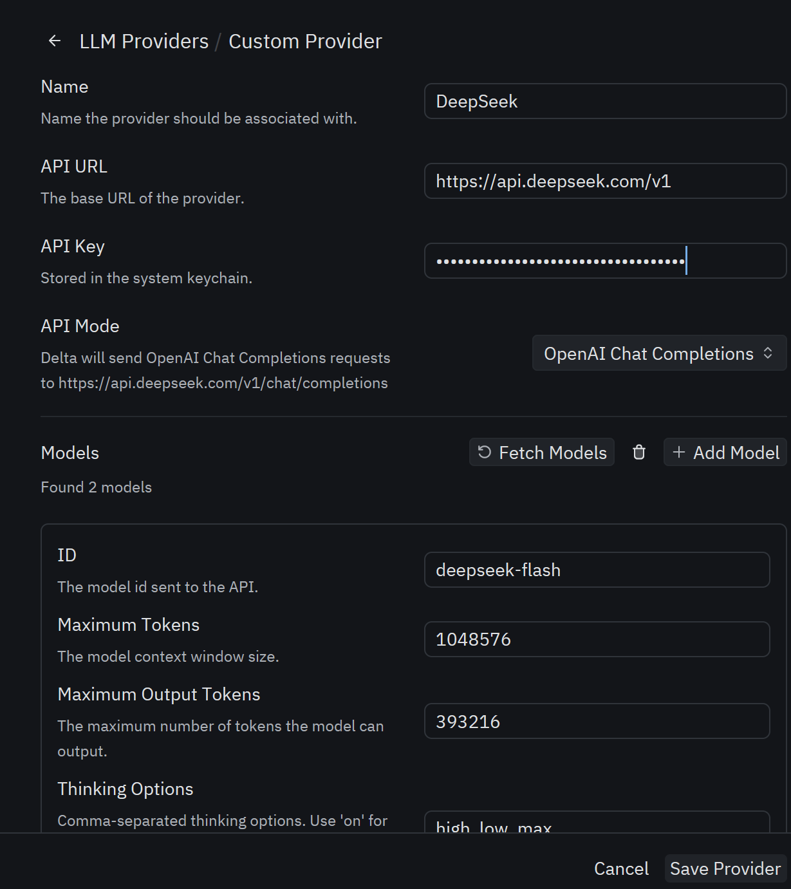
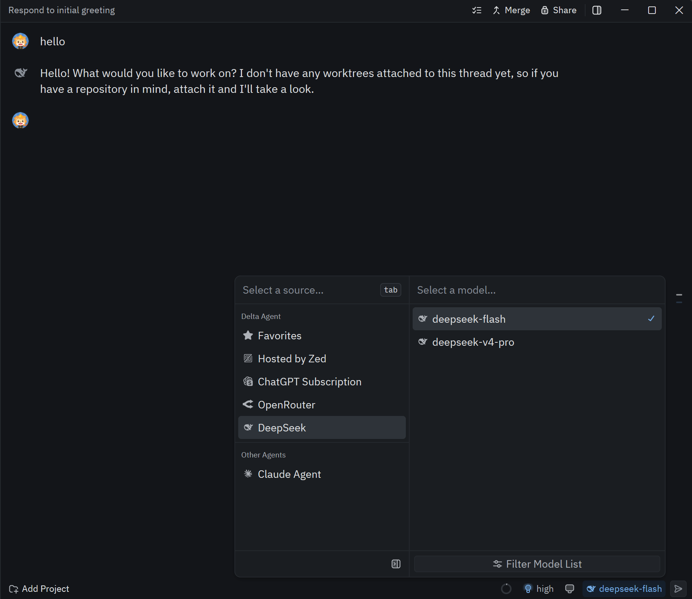

[English](./delta.md) | [简体中文](./delta.zh-CN.md) · [← Back](../README.md)

# Integrate with Delta

Delta is a multiplayer AI coding environment built by the Zed team.

## Installing Delta

Download the Delta installer from the [Delta website](https://delta.dev/download) and install it.

## Configuration

### Prerequisites

You are signed in to Delta with your GitHub account.

### 1. Open Delta Settings

Click your username in the lower-left corner, then select **Settings** (or press `Ctrl+,`).

### 2. Add the DeepSeek Provider

Click **LLM Providers**, then click **Add Provider**.

### 3. Fill in Your Information

First, enter `DeepSeek` (case-insensitive) in **Provider Name** and your [DeepSeek API Key](https://platform.deepseek.com/api_keys) in **API Key**, then click **Save Provider**.
The other fields (API URL, model list, and so on) are usually already filled in automatically.

### 4. Get Started

Pick a DeepSeek model and start using it.

