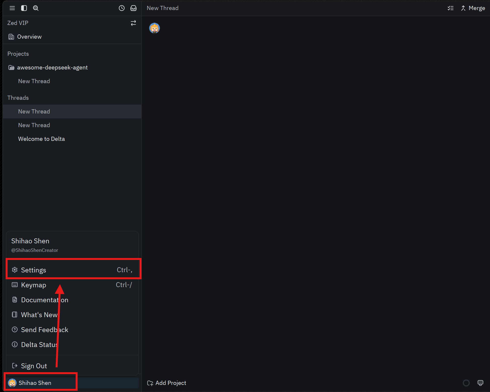
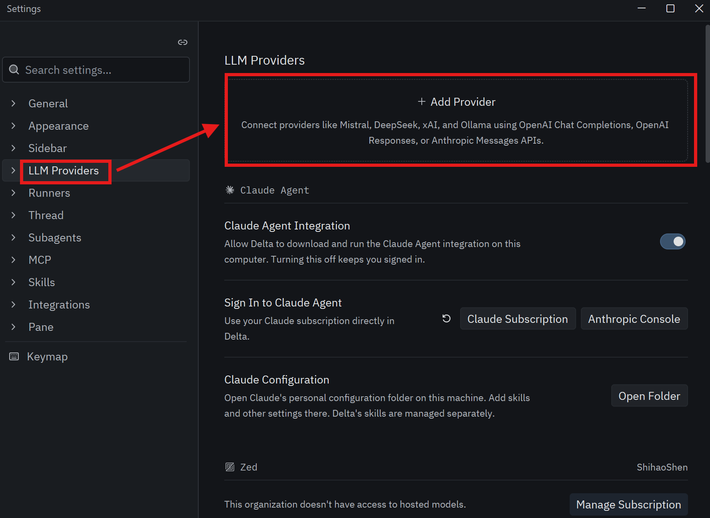
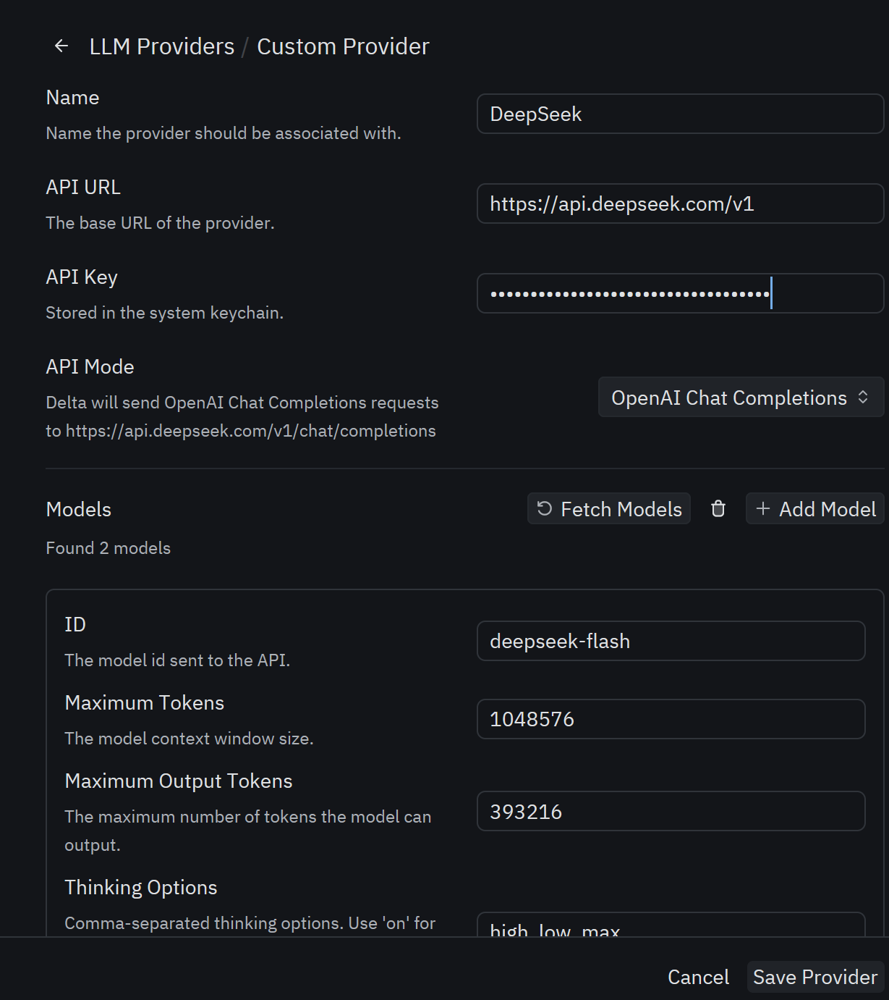
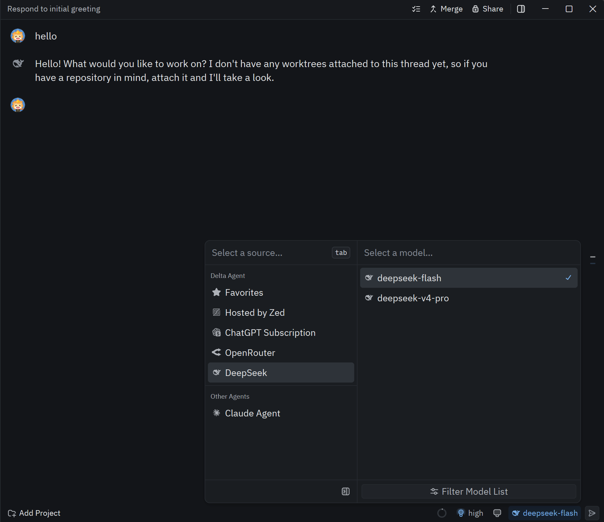

[English](./delta.md) | [简体中文](./delta.zh-CN.md) · [← 返回](../README.zh-CN.md)

# 接入 Delta

Delta 是一个多人协作的 AI 编程环境，由 Zed 团队开发。

## 安装 Delta

从 [Delta 官网](https://delta.dev/download) 下载 Delta 安装包并安装。

## 配置

### 先决条件

你已使用 GitHub 账号登录 Delta。

### 1. 打开 Delta 设置

点击左下角的用户名，然后选择 **Settings**（或使用快捷键 `Ctrl+,`）。

### 2. 添加 DeepSeek 提供方

点击 **LLM Providers**，然后点击 **Add Provider**。

### 3. 填写信息

首先，在 **Provider Name** 中输入 `DeepSeek`（不分大小写），在 **API Key** 中输入你的 [DeepSeek API Key](https://platform.deepseek.com/api_keys)，然后点击 **Save Provider**。
其他信息（API URL 和模型列表等）通常已经自动填写。

### 4. 开始使用

选择一个 DeepSeek 模型，开始使用。

