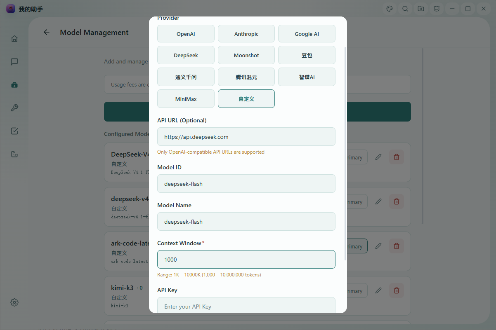
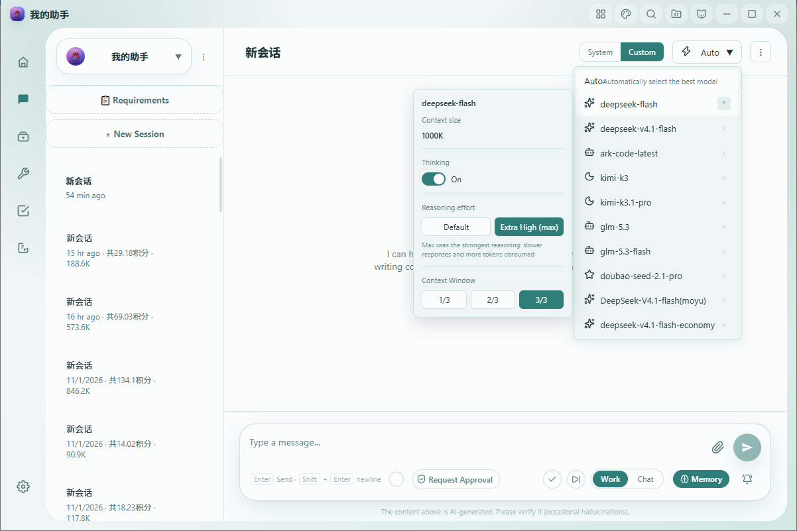

[English](./myassis.md) | [中文](./myassis.zh-CN.md) | [← Back](../README.md)

# Integrate with My Assis

My Assis (我的助手 / myassis) is a local-first AI assistant that connects to OpenAI-compatible and Anthropic-compatible providers with your own API key. It runs on Windows desktop plus iOS and Android mobile, and ships with an agent team, tool calling, long context, persistent memory, scheduled tasks, and desktop automation — so it can both hold everyday conversations and operate your computer.

- **Website:** <https://www.my-assis.com>
- **Platforms:** Windows desktop, iOS, Android

#### 1. Install My Assis

Download the installer from the official website <https://www.my-assis.com> and complete the setup wizard.

- Windows: `.exe` installer
- iOS / Android: mobile builds distributed through the official website and app stores

#### 2. Configure a DeepSeek model

First create an API key on the [DeepSeek Open Platform](https://platform.deepseek.com/api_keys).

Then open **Settings → Model management → Add custom model** and fill in the form:

| Field | Value |
| --- | --- |
| Provider | **Custom** (or **DeepSeek**, which pre-fills the endpoint) |
| API URL | `https://api.deepseek.com` (the `/v1` suffix also works) |
| API Key | Your DeepSeek API key (**left blank in the screenshot**) |
| Model ID | `deepseek-v4-pro` or `deepseek-v4-flash` |
| Total context | `1000` (unit: K = 1,000,000 tokens) |

Click **Save**.

> 📌 **The Model ID must be exact.** My Assis passes `modelId` through to the DeepSeek API verbatim, so it must be one of the two lowercase strings above — no spaces, capitals, or extra suffixes.
>
> The high-speed model is served under both `deepseek-v4-flash` and its current canonical name `deepseek-flash`. The two are equivalent and billed at the same Flash price, so pick whichever your account exposes.

#### 3. Enable the 1M context window

DeepSeek V4 supports a **1,000,000-token** context window (max output 384K), and it needs **no special API parameter**. Setting **Total context** to `1000` (unit: K) is what unlocks the full window in My Assis: the client then stops compressing the conversation history early and keeps everything. The field accepts any value from 1K to 10000K.

#### 4. Set Reasoning effort to Extra High

DeepSeek V4 runs with deep thinking enabled by default, and the official default reasoning effort is `high`. For the strongest performance on hard reasoning, coding, and math tasks you can raise it to the maximum tier.

On the **chat page**, click the model preferences entry next to the current model name at the top to open the preferences panel, then set **Reasoning effort** to **Extra High**:

- **Default** sends no `reasoning_effort` field, keeping the official `high` default.
- **Extra High** sends `reasoning_effort: "max"` in the request body — the string `"max"`, not a number.
- The setting takes effect immediately and is persisted automatically, stored **per conversation × per model**, and it survives a refresh or app restart. The control only appears for DeepSeek models, so models from other providers are unaffected.

> 📌 **Thinking is not Reasoning effort.** The **Thinking** toggle and **Reasoning effort** are two independent controls. Extra High maps only to `reasoning_effort: "max"` and does not require — nor depend on — enabling the Thinking toggle.

#### 5. Verify and go further

Send a message in the conversation, for example: *"Explain what a vector database is in three sentences."* A normal streaming reply confirms that the Model ID, Base URL, and API key are all correct.

Once connected, DeepSeek V4 is available across the rest of My Assis:

- **Agent team.** Split a task across multiple role-based agents that share the same working context.
- **Tool calling.** Let the model read and write files, run scheduled tasks, and automate your desktop.
- **Persistent memory.** Store role, scope, and long-running context per conversation, so agents keep their instructions across sessions.
- **Multi-provider.** Keep DeepSeek alongside other providers and switch models per conversation.
