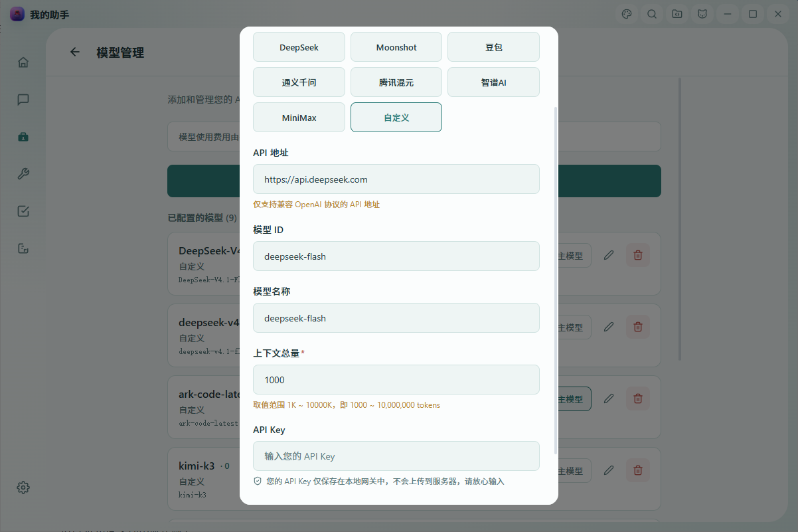
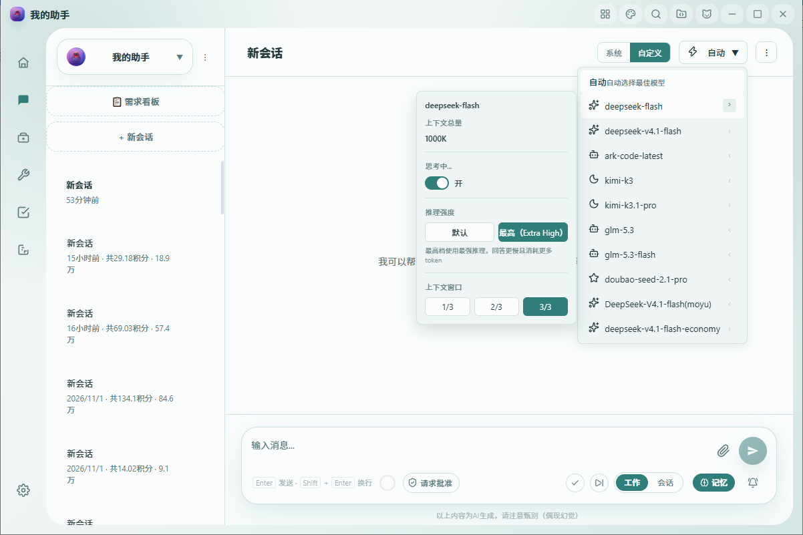

[English](./myassis.md) | [中文](./myassis.zh-CN.md) | [← 返回](../README.zh-CN.md)

# 接入 My Assis

My Assis（我的助手 / myassis）是一款本地优先的 AI 助手，支持自带 API Key 接入 OpenAI 格式与 Anthropic 格式的模型服务。它覆盖 Windows 桌面端与 iOS / Android 移动端，内置 Agent 团队、工具调用、超长上下文、长期记忆、定时任务与桌面自动化能力，既能日常对话，也能操作电脑。

- **官网：** <https://www.my-assis.com>
- **支持平台：** Windows 桌面端、iOS、Android

#### 1. 安装 My Assis

从官网 <https://www.my-assis.com> 下载安装包，按向导完成安装。

- Windows：`.exe` 安装包
- iOS / Android：通过官网与应用商店下载移动端安装包

#### 2. 配置 DeepSeek 模型

先在 [DeepSeek 开放平台](https://platform.deepseek.com/api_keys) 创建一个 API Key。

然后打开 **设置 → 模型管理 → 添加自定义模型**，按下表填写：

| 字段 | 填写内容 |
| --- | --- |
| 提供商 | 选择 **自定义**（也可选 **DeepSeek**，会自动填入接口地址） |
| API 地址 | `https://api.deepseek.com`（带 `/v1` 后缀同样可用） |
| API Key | 粘贴你的 DeepSeek API Key（**截图中留空**，避免泄露） |
| 模型 ID | `deepseek-v4-pro` 或 `deepseek-v4-flash` |
| 上下文总量 | `1000`（单位 K，即 1,000,000 tokens） |

填写完成后点击 **保存**。

> 📌 **模型 ID 必须完全一致。** My Assis 会把 `modelId` 原样透传给 DeepSeek API，因此必须严格使用上面两个小写字符串之一——不要加空格、大写字母或任何后缀。
>
> 轻量高速模型目前同时支持 `deepseek-v4-flash` 与其当前正式名称 `deepseek-flash`，两者等价、按同一 Flash 价格计费，选你账号里能取到的那个即可。

#### 3. 开启 1M 上下文

DeepSeek V4 支持 **1,000,000 tokens** 上下文窗口（最大输出 384K），并且**不需要任何额外 API 参数**。在 My Assis 中，只要把 **上下文总量** 设为 `1000`（单位 K）即可用满：客户端此后不会提前压缩对话历史，完整保留全部上下文。该字段的可填范围为 1K–10000K。

#### 4. 将推理强度调到「最高」

DeepSeek V4 默认已开启深度思考，官方默认推理强度为 `high`。在处理复杂推理、代码与数学任务时，可以把推理强度提到最高档。

在**对话页**点击顶部当前模型名称旁边的模型偏好入口，打开偏好面板，把 **推理强度** 设为 **最高（Extra High）**：

- 选择 **默认**：不发送 `reasoning_effort` 字段，沿用官方 `high` 默认值。
- 选择 **最高**：请求体中发送 `reasoning_effort: "max"`——注意是字符串 `"max"`，不是数字。
- 设置立即生效并自动持久化，按「会话 × 模型」独立保存，刷新页面或重启应用后仍然保留。该选项仅对 DeepSeek 模型显示，不会影响其他厂商的模型。

> 📌 **「思考」与「推理强度」是两回事。** 面板里的 **思考** 开关与 **推理强度** 是两个独立设置。最高档只对应 `reasoning_effort: "max"`，既不需要、也不依赖开启思考开关。

#### 5. 验证并继续探索

在对话中发送一条消息，例如：*「用三句话解释什么是向量数据库。」* 如果能正常流式返回回复，说明模型 ID、接口地址与 API Key 都配置正确。

接入成功后，DeepSeek V4 可以在 My Assis 的其他能力中使用：

- **Agent 团队。** 把一个任务拆给多个角色化 Agent 协作，共享同一份工作上下文。
- **工具调用。** 让模型读写文件、执行定时任务、自动化操作桌面。
- **长期记忆。** 按会话保存角色、职责与长期上下文，Agent 跨会话保持设定。
- **多模型并存。** DeepSeek 与其他厂商模型共存，按会话自由切换。
