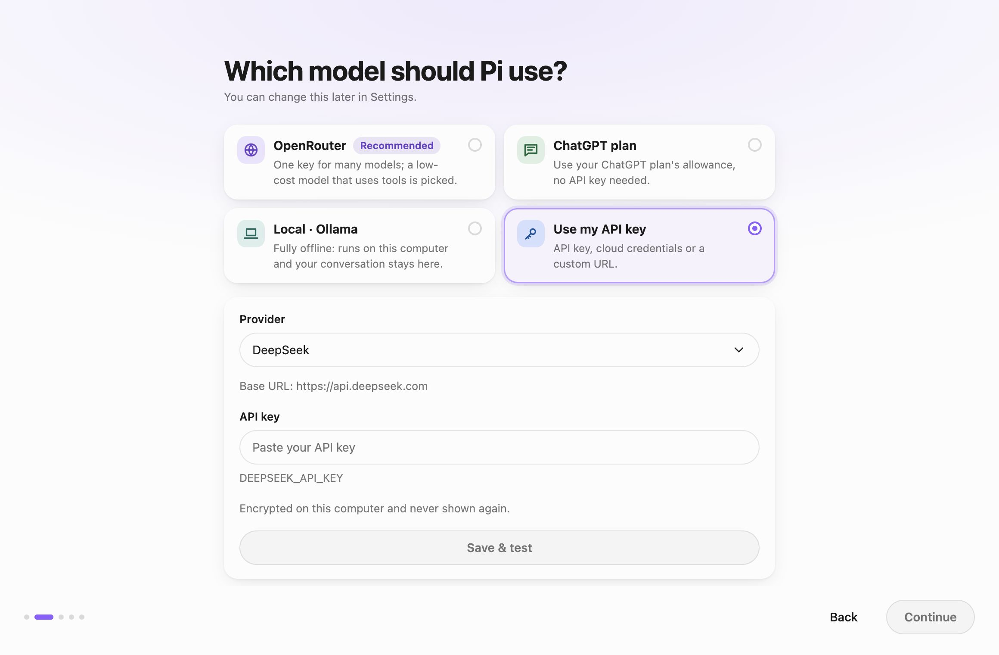

[English](./pi_bot.md) | [简体中文](./pi_bot.zh-CN.md) · [← Back](../README.md)

# Use DeepSeek in Pi Bot

[Pi Bot](https://github.com/w01fb0ss/PiBot) is an Apache-2.0 desktop app for working with named AI agents individually or in groups. The built-in DeepSeek provider connects directly to `https://api.deepseek.com`.

## 1. Install Pi Bot and get an API key

1. Download [Pi Bot v0.0.3](https://github.com/w01fb0ss/PiBot/releases/tag/v0.0.3) for your desktop. Choose the matching `.dmg` for macOS, the `.exe` installer for Windows, or the `.AppImage` for Linux.
2. Sign in to the [DeepSeek Platform](https://platform.deepseek.com/api_keys) and create an API key.

## 2. Connect the built-in DeepSeek provider

- **First launch in English:** Choose **Use my API key**, then select **DeepSeek**.
- **First launch in Simplified Chinese:** **DeepSeek** is the first, recommended option on the model screen. Pi Bot preselects **DeepSeek V4.1 Flash**.
- **Already set up:** Go to **Settings → Models & API keys → Add a provider** and select **DeepSeek**.

Paste the DeepSeek key into **API key** and click **Save & test**. After the connection test passes, pick a model and click **Continue** in setup, or select it as the **Default model** in Settings. You can also choose a model for a single Bot in that Bot's profile.

| Model in Pi Bot | DeepSeek API ID |
| --- | --- |
| DeepSeek V4.1 Flash | `deepseek-flash` |
| DeepSeek V4 Pro | `deepseek-v4-pro` |

Both models support a **1 million token** context window according to [DeepSeek Models & Pricing](https://api-docs.deepseek.com/quick_start/pricing/). Pi Bot ships the model limits in its catalog.

For reasoning tasks, choose **High** under **Reasoning effort** for the default model or in the Bot's profile. In v0.0.3, **High** enables thinking and sends `reasoning_effort: "high"`. DeepSeek's API also offers `max`. Pi Bot v0.0.3 does not expose that level in the desktop selector. See [DeepSeek Thinking Mode](https://api-docs.deepseek.com/guides/thinking_mode/).

## 3. Send a first message

Open a direct chat with **Pi**, confirm that its model is a DeepSeek model, and send a short prompt such as `Reply with "DeepSeek is connected."` A reply confirms that the Bot can use the configured provider.

If **Save & test** fails, check the API key and your DeepSeek account balance. If the connection test passes and the Bot fails to reply, check the model selected in the Bot's profile. [Pi Bot model troubleshooting](https://github.com/w01fb0ss/PiBot/blob/v0.0.3/docs/guide/en/09-models-and-keys.md#troubleshoot-a-model-connection)

The API key is stored encrypted on your computer. Pi Bot sends the context needed for the reply to DeepSeek when the Bot uses a DeepSeek model. [Pi Bot outbound connections](https://github.com/w01fb0ss/PiBot/blob/v0.0.3/docs/privacy/en/outbound-connections.md)
