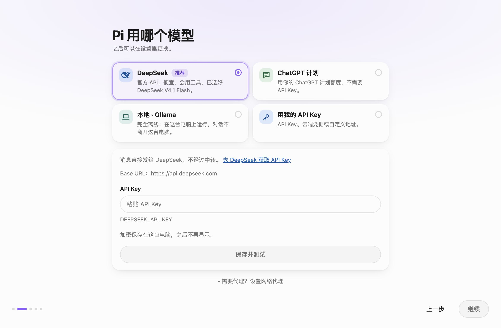

[English](./pi_bot.md) | [简体中文](./pi_bot.zh-CN.md) · [← 返回](../README.zh-CN.md)

# 在 Pi Bot 中使用 DeepSeek

[Pi Bot](https://github.com/w01fb0ss/PiBot) 是采用 Apache-2.0 许可证的桌面应用，可以和具名 Bot 私聊，也可以把多个 Bot 拉进群里分工。内置 DeepSeek 供应商直接连接 `https://api.deepseek.com`。

## 1. 安装 Pi Bot 并获取 API Key

1. 从 [Pi Bot v0.0.3 发布页](https://github.com/w01fb0ss/PiBot/releases/tag/v0.0.3) 下载桌面安装包。macOS 选择适合芯片的 `.dmg`，Windows 选择 `.exe`，Linux 选择 `.AppImage`。
2. 登录 [DeepSeek 开放平台](https://platform.deepseek.com/api_keys)，创建一个 API Key。

## 2. 接入内置 DeepSeek 供应商

- **简体中文首次启动**时，在欢迎页选择 **中文**，点击 **开始使用**。进入模型选择页后，第一项是推荐的 **DeepSeek**，预选 **DeepSeek V4.1 Flash**。
- **英文首次启动**时，选择 **Use my API key**，然后选 **DeepSeek**。
- **已经完成引导**时，在 **设置 → 模型与密钥 → 添加厂商** 中选择 **DeepSeek**。

在 **API Key** 输入框粘贴密钥，点击 **保存并测试**。连接测试通过后，选择模型并在引导里点 **继续**，或者在设置里将它设为 **默认模型**。也可以在 Bot 资料里单独给某个 Bot 选择 DeepSeek 模型。

| Pi Bot 中的模型 | DeepSeek API 模型 ID |
| --- | --- |
| DeepSeek V4.1 Flash | `deepseek-flash` |
| DeepSeek V4 Pro | `deepseek-v4-pro` |

这两个模型都支持 **100 万 token** 上下文。Pi Bot 内置模型目录已包含相关限制。 [DeepSeek 模型与价格](https://api-docs.deepseek.com/zh-cn/quick_start/pricing/)

如果任务需要推理，可以在默认模型旁或 Bot 资料里将 **思考强度** 设为 **高**。v0.0.3 中，「高」会启用思考模式并发送 `reasoning_effort: "high"`。DeepSeek API 也支持 `max`，Pi Bot v0.0.3 的桌面下拉框尚未提供这一档。 [DeepSeek 思考模式](https://api-docs.deepseek.com/zh-cn/guides/thinking_mode/)

## 3. 发送第一条消息

打开与 **Pi** 的私聊，确认它选用的是 DeepSeek 模型，再发送一句简单的测试消息，例如「请回复：DeepSeek 已连接。」收到回复后，就可以开始使用这个 Bot。

如果 **保存并测试**失败，先检查密钥和 DeepSeek 账户余额。测试通过后聊天仍报错时，检查 Bot 资料里实际选择的模型。 [Pi Bot 模型连接排查](https://github.com/w01fb0ss/PiBot/blob/v0.0.3/docs/guide/zh/09-models-and-keys.md)

密钥在本机加密保存。Bot 使用 DeepSeek 模型时，生成回复所需的上下文会发送给 DeepSeek。 [Pi Bot 出站连接说明](https://github.com/w01fb0ss/PiBot/blob/v0.0.3/docs/privacy/zh/outbound-connections.md)
