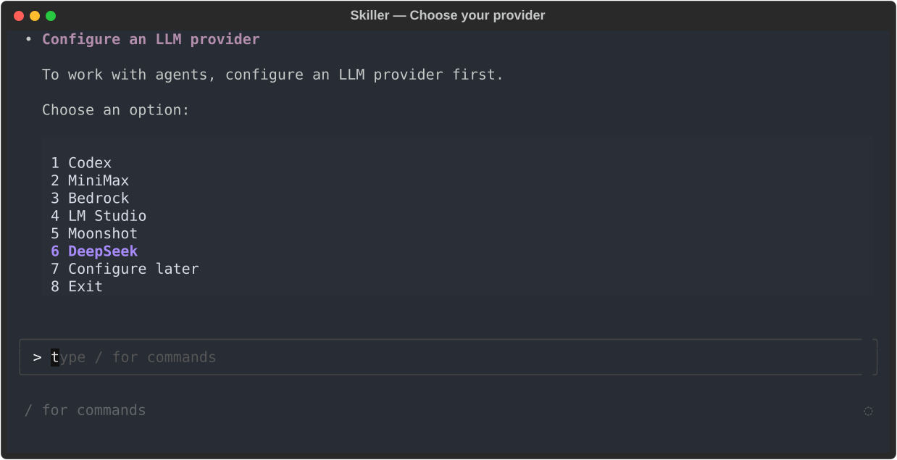
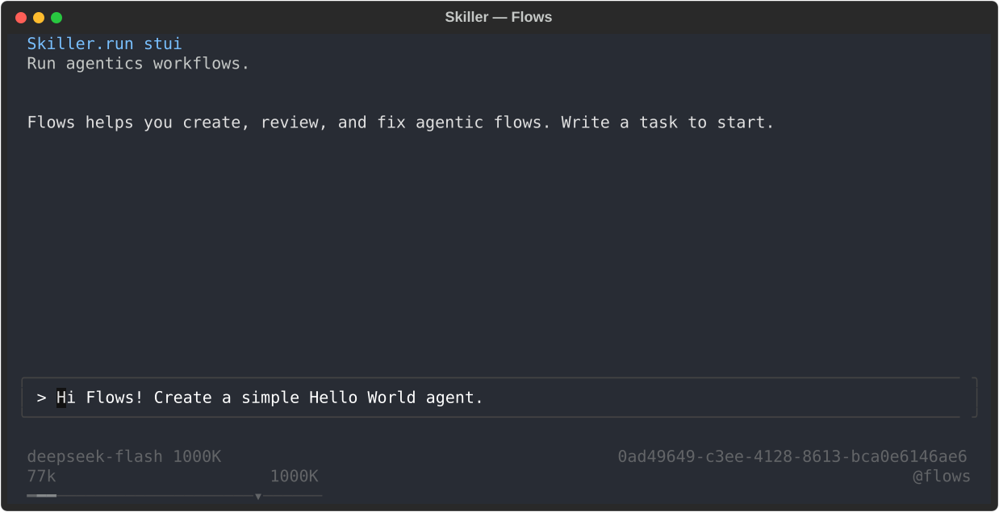
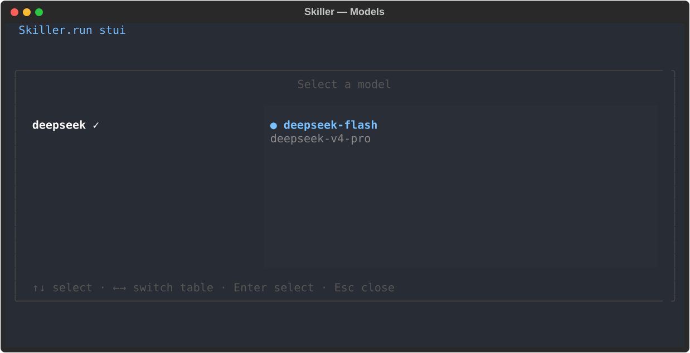

# Use DeepSeek with Skiller

## 1. What is Skiller?

[Skiller](https://skiller.run) is a runtime for AI agents defined in YAML. It lets you combine agents, tools, and deterministic steps into stateful workflows, then run and interact with them through a CLI or the terminal user interface (STUI).

## 2. Install Skiller

You need Python 3.11 or later. Install Skiller with pipx:

```bash
pipx install skiller
skiller --version
```

See the [installation guide](https://skiller.run/docs/getting-started/installation/) if you prefer a virtual environment.

## 3. Launch STUI for the first time and connect DeepSeek

Run this command to open the terminal interface:

```bash
skiller
```

### Choose DeepSeek

On first launch, Skiller asks you to choose an LLM provider. Choose option **6** for **DeepSeek**.



### Enter your DeepSeek API key

Enter your API key from [DeepSeek Platform](https://platform.deepseek.com/). The flow verifies the connection and saves the key to `~/.skiller/secrets/deepseek_api_key`, creating the file with restrictive permissions. Once finished, it cleans up the setup run data, including the input containing the key; the provider configuration only references the secret file.

## 4. Chat with Flows to create your agentic workflows

After authentication, the Flows agent starts. If it does not, start a new instance with `/run @flows` in STUI and describe what you want to build. For example:

> Hi Flows! Create a simple Hello World agent.



<!-- Reproducible capture of the real interface with staged state using Textual run_test; no model call. -->

## 5. Switch models

Type `/models` in STUI, select the DeepSeek provider and your preferred model, then press Enter to confirm.



<!-- STUI capture with illustrative state prepared using Textual run_test; no real configuration was read or changed. -->

## 6. Configure maximum reasoning and a one-million-token context window

Flows uses the profile at `~/.skiller/settings/agent.flows.json`. Add or update the `llm` and `context` sections of that file as shown below, preserving the other existing sections, especially `tools`:

```json
{
  "llm": {
    "provider": "deepseek",
    "model": "deepseek-v4-pro",
    "effort": 5
  },
  "context": {
    "window_width_tokens": 1000000,
    "compaction": {
      "compaction_trigger_ratio": 0.8,
      "compaction_target_ratio": 0.3,
      "keep_last_blocks": 10
    }
  }
}
```

For more details on context windows and compaction, see the [context configuration reference](https://skiller.run/docs/configuration/context-settings/).

| `llm.effort` | Sent as `reasoning_effort` | Level applied by DeepSeek |
|---|---|---|
| 1 | `low` | `low` |
| 2 | `medium` | `high` |
| 3 | `high` | `high` |
| 4 | `xhigh` | `high` |
| 5 | `max` | `max` |
