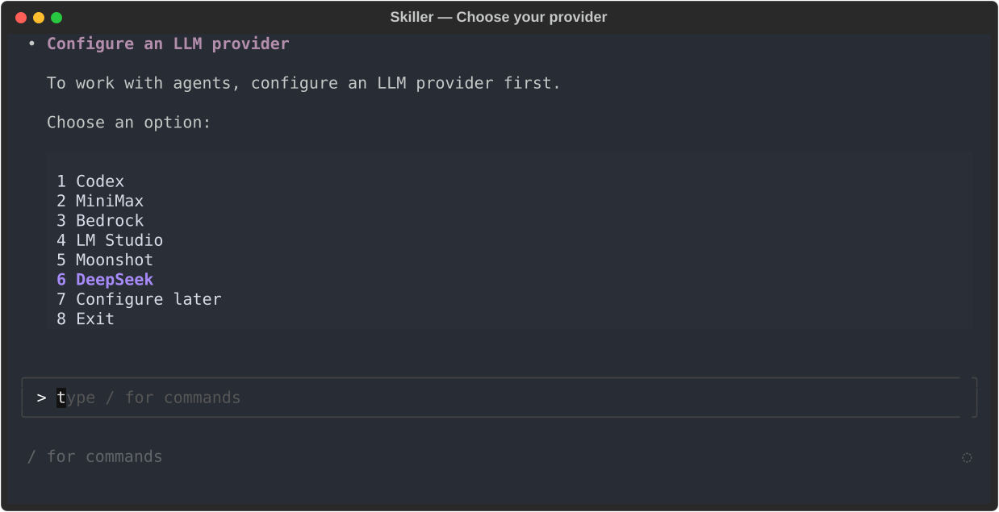
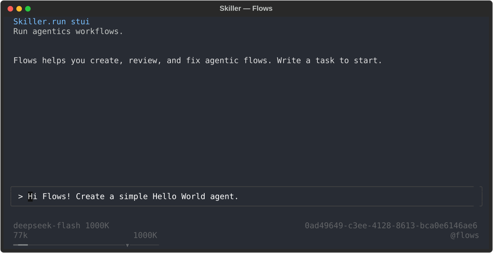
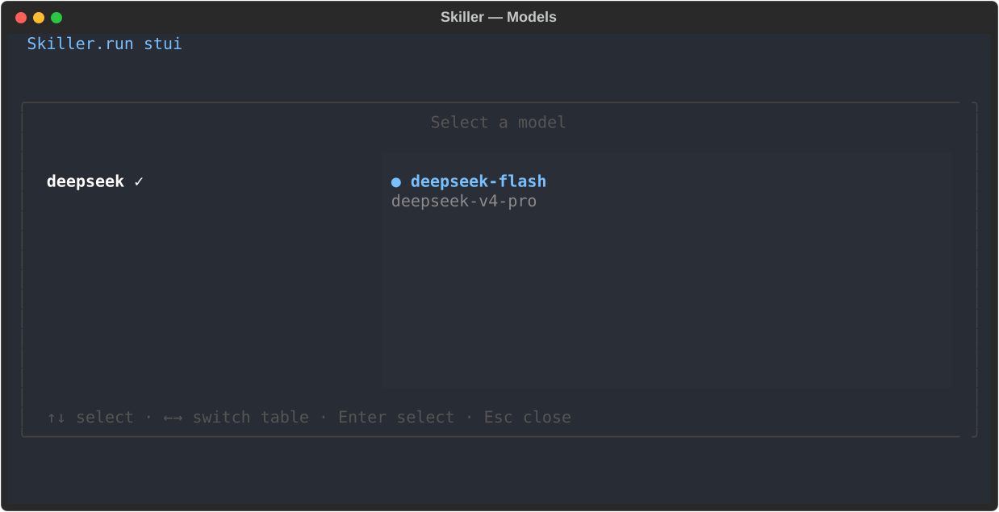

# 在 Skiller 中使用 DeepSeek

## 1. 什么是 Skiller？

[Skiller](https://skiller.run) 是一个用于运行 YAML 定义的 AI Agent 的运行时。你可以将 Agent、工具和确定性步骤组合成有状态的工作流，并通过 CLI 或终端用户界面（STUI）运行这些工作流、与其交互。

## 2. 安装 Skiller

需要 Python 3.11 或更高版本。使用 pipx 安装 Skiller：

```bash
pipx install skiller
skiller --version
```

如果你更喜欢使用虚拟环境，请参阅[安装指南](https://skiller.run/docs/getting-started/installation/)。

## 3. 首次启动 STUI 并连接 DeepSeek

运行以下命令打开终端界面：

```bash
skiller
```

### 选择 DeepSeek

首次启动时，Skiller 会提示你选择 LLM 提供商。选择 **6**，即 **DeepSeek**。



### 输入 DeepSeek API Key

输入你在 [DeepSeek 开放平台](https://platform.deepseek.com/) 获取的 API Key。该流程会验证连接，并将密钥保存到 `~/.skiller/secrets/deepseek_api_key`，创建文件时设置严格的访问权限。完成后，流程会清理配置运行的数据，包括包含密钥的输入；提供商配置仅引用密钥文件。

## 4. 与 Flows 对话，创建智能体工作流

身份验证完成后，Flows Agent 会启动。如果没有启动，请在 STUI 中输入 `/run @flows` 创建一个新实例，然后描述你想构建的内容。例如：

> Hi Flows! Create a simple Hello World agent.



<!-- 使用 Textual run_test 和预设状态生成的真实界面截图，未调用模型。 -->

## 5. 切换模型

在 STUI 中输入 `/models`，选择 DeepSeek 提供商及所需模型，然后按 Enter 确认。



<!-- 使用 Textual run_test 和示例状态生成的 STUI 截图，未读取或修改实际配置。 -->

## 6. 配置最高推理强度和一百万 token 上下文窗口

Flows 使用 `~/.skiller/settings/agent.flows.json` 配置文件。按照以下示例添加或更新该文件中的 `llm` 和 `context` 部分，保留其他现有部分，尤其是 `tools`：

```json
{
  "llm": {
    "provider": "deepseek",
    "model": "deepseek-v4-pro",
    "effort": 5
  },
  "context": {
    "window_width_tokens": 1000000,
    "compaction": {
      "compaction_trigger_ratio": 0.8,
      "compaction_target_ratio": 0.3,
      "keep_last_blocks": 10
    }
  }
}
```

有关上下文窗口和压缩的更多详情，请参阅[上下文配置参考](https://skiller.run/docs/configuration/context-settings/)。

| `llm.effort` | 发送的 `reasoning_effort` | DeepSeek 实际应用的级别 |
|---|---|---|
| 1 | `low` | `low` |
| 2 | `medium` | `high` |
| 3 | `high` | `high` |
| 4 | `xhigh` | `high` |
| 5 | `max` | `max` |
